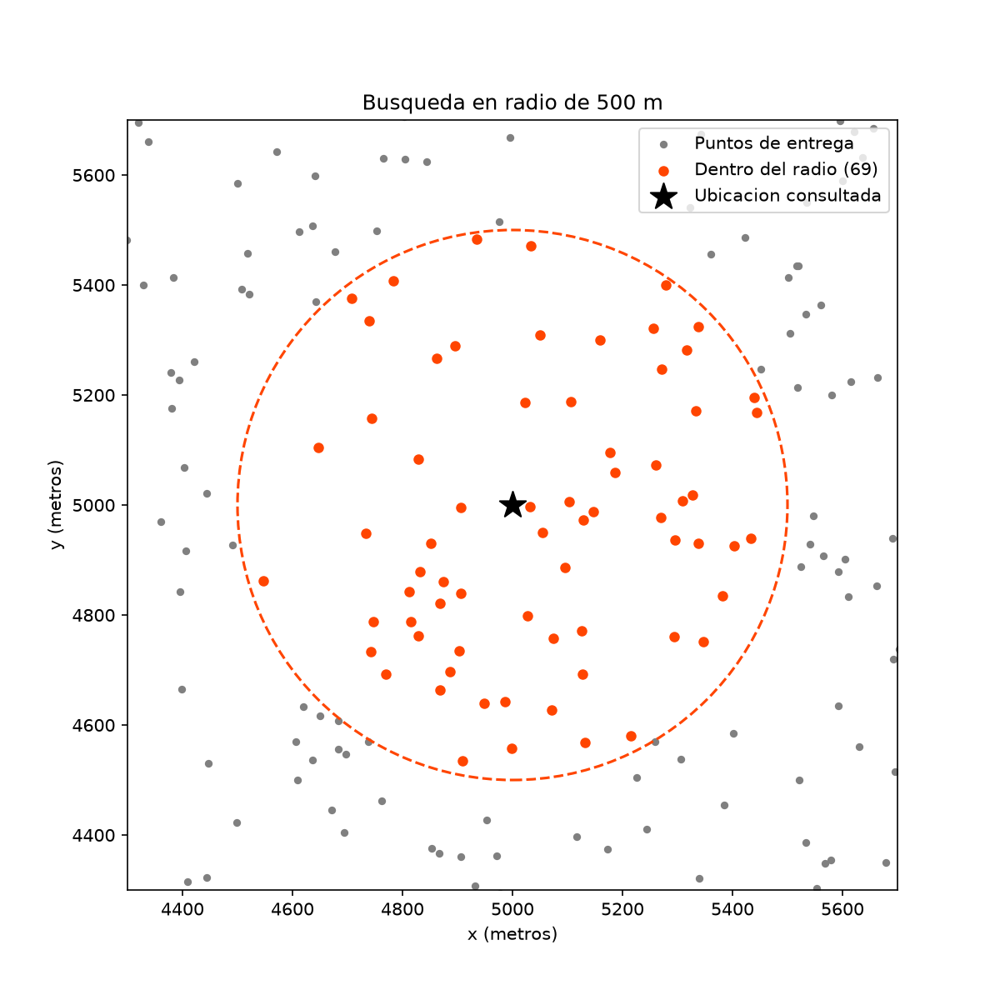
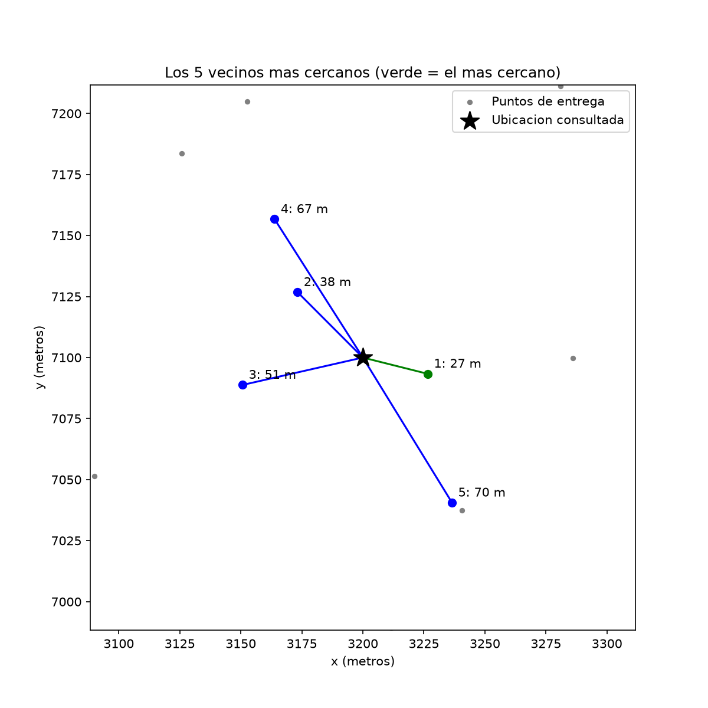
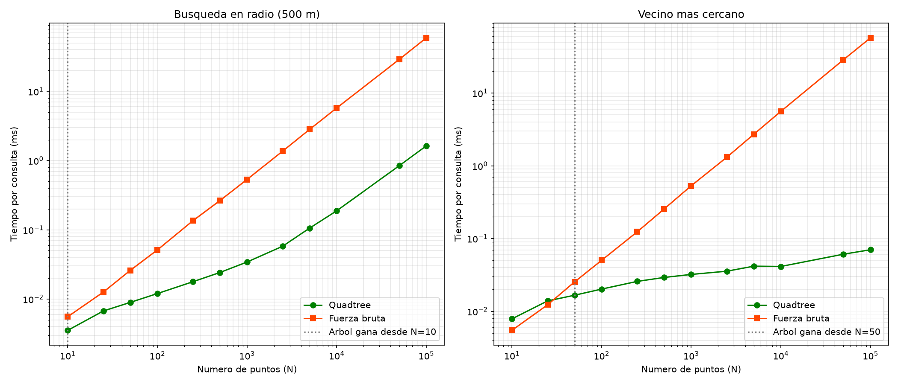

# Laboratorio 4: Quadtree para logística de entregas

Sistema que responde, sobre 10.000 puntos de entrega con coordenadas (x, y):

- ¿Qué puntos de entrega están a un radio de 500 metros de un punto dado?
- ¿Cuál es el punto de entrega más cercano a una ubicación dada? (y los k más cercanos)
- De los puntos dentro del radio (vecinos), ¿cuáles son los más cercanos?

Se implementa un árbol Quadtree desde cero (sin scipy ni librerías de árboles) y se compara contra fuerza bruta.

## Estructura

```
README.md
Quadtreetree.py    árbol Quadtree k-dimensional + funciones de fuerza bruta
test.py            pruebas unitarias y gráficas de verificación visual
analisis.py        medición de tiempos y discusión de resultados
graficas/          busqueda_radio.png, vecinos_cercanos.png (test.py)
                   comparacion_tiempos.png (analisis.py)
resultados_pruebas.txt    salida de test.py: análisis de las pruebas (árbol vs fuerza bruta)
resultados_analisis.txt   salida de analisis.py: tabla de tiempos y discusión
```

## Cómo ejecutar

Requiere Python 3 y matplotlib (`pip install matplotlib`).

```
python Quadtreetree.py   # ejemplo rápido
python test.py           # pruebas unitarias + gráficas de verificación + análisis de pruebas
python analisis.py       # comparación de tiempos + gráfica comparativa (correr sin depurador)
```

## Datos y unidades

Los 10.000 puntos se generan al azar con semilla fija (`semilla=42`), así que siempre son los mismos (datos estáticos). Representan una ciudad de 10.000 m × 10.000 m y **todas las coordenadas están en metros**, por lo que el radio de búsqueda es directamente `500`. Si se usaran coordenadas reales de GPS (latitud/longitud), habría que convertir grados a metros antes, porque un grado no equivale a una distancia fija.

## Cómo funciona el Quadtree

Cada nodo representa una región rectangular del mapa. Si una región tiene más de 4 puntos (`capacidad`), se divide por la mitad en cada dimensión y sus puntos se reparten entre los hijos. Así, las zonas con muchos puntos quedan divididas en cuadros pequeños y las zonas vacías en cuadros grandes.

**K dimensiones (hiperoctree):** la división usa `itertools.product([0, 1], repeat=k)`, que genera todas las combinaciones de "mitad inferior" (0) o "mitad superior" (1) por dimensión. En 2D salen 4 hijos (quadtree), en 3D 8 (octree) y en K dimensiones 2^K. El mismo código funciona para cualquier K; las pruebas verifican 2D, 3D y 4D.

**Búsqueda en radio:** para cada nodo se calcula la distancia mínima entre el centro de búsqueda y el rectángulo del nodo. Si esa distancia es mayor que el radio, el círculo no toca la región y se descarta completa sin revisar sus puntos (poda). Solo en las hojas que sí tocan el círculo se mide la distancia a cada punto.

**Vecinos dentro del radio:** `vecinos_en_radio` toma los puntos encontrados en el círculo y los ordena por distancia, del más cercano al más lejano. El primero es el vecino más cercano dentro del radio.

**Vecinos más cercanos (k-NN):** se mantiene una lista con los k mejores candidatos encontrados. Los hijos se visitan del más cercano al más lejano, y una región se descarta si su distancia mínima es mayor que la del peor candidato actual: ahí no puede haber nada mejor.

**Caso borde:** si hay muchos puntos repetidos en el mismo lugar, dividir nunca los separaría y la recursión sería infinita. Por eso, a profundidad 20 el nodo deja de dividirse y guarda los puntos que lleguen.

## Verificación

`test.py` contiene 14 pruebas unitarias. La idea central es que la fuerza bruta siempre es correcta, así que el árbol debe dar exactamente los mismos resultados en 50 consultas al azar (radio, más cercano y 5 vecinos). También se verifica que los vecinos dentro del radio salgan ordenados, y se prueban casos borde: radio 0, consultas fuera del mapa, k mayor que el número de puntos, puntos repetidos, y árboles en 3D y 4D.

### Gráfica 1: búsqueda en radio de 500 m
Los puntos naranjas son los encontrados por el árbol; todos quedan dentro del círculo y coinciden con la fuerza bruta (69 puntos).



### Gráfica 2: los 5 vecinos más cercanos
La estrella es la ubicación consultada; las líneas la unen con sus 5 vecinos más cercanos, numerados por distancia. El verde es el más cercano. Coinciden con la fuerza bruta.



## Análisis comparativo

Tiempo promedio por consulta (100 consultas al azar por tamaño), en milisegundos. Cada medición se repite 3 veces y se toma la más rápida: el ruido del sistema operativo solo puede sumar tiempo, nunca restarlo, así que el mínimo es la medición más cercana al tiempo real (igual que hace `timeit`). Las pruebas se corrieron sin depurador.


| N | Construir árbol | Radio árbol | Radio bruta | Vecino árbol | Vecino bruta |
|---:|---:|---:|---:|---:|---:|
| 10 | 0.03 | 0.0035 | 0.0056 | 0.0079 | 0.0055 |
| 25 | 0.08 | 0.0067 | 0.0126 | 0.0139 | 0.0123 |
| 50 | 0.18 | 0.0090 | 0.0260 | 0.0166 | 0.0253 |
| 100 | 0.36 | 0.0120 | 0.0512 | 0.0202 | 0.0501 |
| 1.000 | 5.01 | 0.0342 | 0.5334 | 0.0321 | 0.5306 |
| 10.000 | 77.34 | 0.1878 | 5.7424 | 0.0413 | 5.5900 |
| 100.000 | 1244.35 | 1.6288 | 59.2602 | 0.0701 | 57.2739 |

*(Los tiempos exactos cambian según el computador; `analisis.py` imprime la tabla completa.)*

### Gráfica 3: comparación de tiempos
Eje x: número de puntos N. Eje y: tiempo de una consulta en milisegundos. Ambos ejes en escala logarítmica porque N va de 10 a 100.000. La línea punteada gris marca desde qué N gana el árbol.



### ¿Para qué tamaño de datos el Quadtree comienza a ser más rápido que la fuerza bruta?

Mirando solo el tiempo de cada consulta (con el árbol ya construido):

- **Vecino más cercano:** el árbol gana desde **N ≈ 50 puntos**. Con 10 y 25 puntos la fuerza bruta es igual o más rápida, porque el árbol tiene costos fijos (recursión, ordenar hijos, calcular distancias a los cuadros) que no se compensan cuando hay tan poco que descartar.
- **Búsqueda en radio:** el árbol gana prácticamente desde el inicio (con N = 10 casi empatan). Esto pasa porque un círculo de 500 m es muy pequeño comparado con una ciudad de 10 km, así que casi todo el mapa se descarta de inmediato.

Si se incluye el costo de **construir** el árbol, para una sola consulta siempre gana la fuerza bruta. Pero como los datos son estáticos, el árbol se construye una sola vez: con 10.000 puntos, construirlo tarda unos 77 ms y ese costo se recupera después de unas 14 consultas de vecino más cercano. En un sistema de entregas que responde miles de consultas, el árbol es claramente mejor.

### Discusión

- La fuerza bruta crece de forma lineal, O(N): con 10 veces más puntos tarda 10 veces más. En la gráfica (escala logarítmica) se ve como una línea recta con pendiente 1.
- El vecino más cercano con el árbol casi no cambia entre 10.000 y 100.000 puntos (entre 0,04 y 0,07 ms), mientras la fuerza bruta pasa de 6 a 57 ms. Con datos uniformes cada consulta cuesta aproximadamente O(log N).
- La búsqueda en radio con el árbol sí crece con N, pero porque hay más puntos dentro del círculo (con 100.000 puntos caen unos 785), y esos hay que devolverlos todos. Aun así es unas 36 veces más rápida que la fuerza bruta.
- Con N = 10.000 (el caso del enunciado), el árbol es unas 31 veces más rápido en radio y unas 135 veces más rápido en vecino más cercano.
- Limitación: en muchas dimensiones (K grande) cada nodo tiene 2^K hijos, lo que se vuelve costoso. Para K alto suele preferirse un KD-tree, que divide una dimensión a la vez.

## Código de honor

Declaro que este laboratorio se realizó con apoyo de inteligencia artificial (Claude, de Anthropic), como lo permite el enunciado.

**Lo que hice yo:**
- Escribí las funciones de fuerza bruta (`fuerza_bruta_radio`, `fuerza_bruta_mas_cercano` y `fuerza_bruta_k_vecinos`).
- Escribí las funciones del Quadtree: la construcción (`dividir`, `insertar`, `contiene`), la poda (`distancia_minima`) y la búsqueda en radio (`buscar_radio`), y puedo explicar.
- Ejecuté el código en mi computador, verifiqué que las 14 pruebas pasaran y generé las gráficas y los tiempos de este repositorio.
- Revisé los resultados y repetí las mediciones cuando salieron valores anómalos.

**Cómo usé la IA:**
- Para entender el problema y el funcionamiento del Quadtree.
- Para ayudarme a escribir el codigo de las pruebas y el análisis. La función en la que más me apoyé en el codigo del arbol fue en la de el Ejemplo rápido y en la de `buscar_cercanos`.
- Para escribir los comentarios del código de forma más técnica y entendible.
- GitHub Copilot se usó para ejecutar los scripts y guardar su salida en `resultados_pruebas.txt` y `resultados_analisis.txt`.
- Me apoye para hacer el README.md y que me quedara bien organizado.

No se copió código de soluciones publicadas en internet. Todos los resultados reportados se obtuvieron en mi computador.

*Xiomara Echavarria Gallego*
